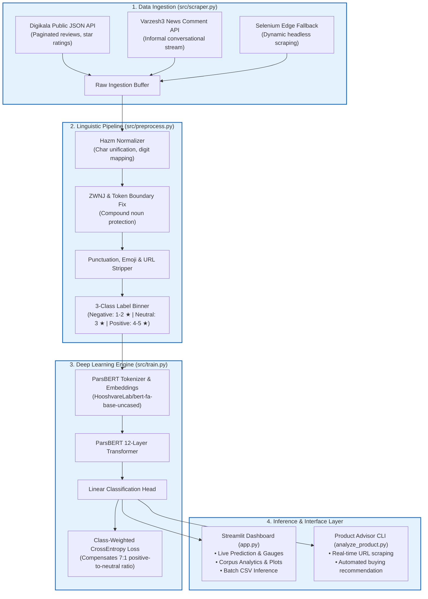

# 🧠 BAFP: ParsBERT Persian Sentiment Engine & E-Commerce Product Advisor

<div align="center">

[](https://www.python.org/)
[](https://pytorch.org/)
[](https://huggingface.co/HooshvareLab/bert-fa-base-uncased)
[](https://streamlit.io/)
[](https://github.com/sobhe/hazm)
[](https://opensource.org/licenses/MIT)

**موتور پردازش زبان طبیعی و تحلیل احساسات نظرات فارسی با مدل ترنسفورمر ParsBERT و مشاور هوشمند خرید دیجی‌کالا**

*An end-to-end, production-grade Persian NLP pipeline: from high-throughput API ingestion and linguistic normalization to fine-tuned transformer inference and interactive decision-support dashboards.*

</div>

---

## 🌟 Overview & Highlights

**BAFP** (*Bilingual/Advanced Feedback Processing*) is a specialized Persian natural language processing suite engineered to tackle the authentic complexities of informal Persian e-commerce reviews and real-time news comments.

Built on top of **ParsBERT** (`HooshvareLab/bert-fa-base-uncased`), BAFP delivers:
- 🚀 **Real-Time Digikala Product Advisor (`analyze_product.py`)**: Pass any Digikala URL or DKP code to instantly harvest customer reviews, classify sentiment probabilities, extract top pros/cons keywords, and calculate an objective purchase verdict (`خرید` / `احتیاط` / `عدم خرید`).
- 📊 **Streamlit 4-Page Analytics Suite (`app.py`)**: A modern Persian-first RTL dashboard featuring live prediction gauges, dataset-wide corpus analytics, multi-file batch CSV processing, and model diagnostics.
- ⚡ **Multi-Source Data Ingestion Engine (`src/scraper.py`)**: High-speed, rate-limit-conscious ingestion for Digikala public endpoints, Varzesh3 news comments, and Selenium-driven browser fallback.
- 🔬 **Linguistic Normalization Pipeline (`src/preprocess.py`)**: Custom `hazm`-powered pipeline handling half-spaces (ZWNJ / نیم‌فاصله), Arabic-Persian character unification (`ي` $\rightarrow$ `ی`, `ك` $\rightarrow$ `ک`), Persian numeral transliteration, and conversational noise reduction.
- ⚖️ **Imbalance-Aware Fine-Tuning (`src/train.py`)**: Class-weighted Cross-Entropy loss counteracting the severe skew of Iranian consumer reviews (~71% positive, ~19% negative, ~9% neutral).

---

## 📸 Visual Showcase

### Sentiment Word Clouds (Vazirmatn Typography)
Pre-shaped using bidirectional Unicode algorithms (`arabic-reshaper` + `python-bidi`) and rendered with Vazirmatn typography:

<div align="center">
  <table>
    <tr>
      <td align="center"><b>🟢 Positive Sentiment Cloud (نظرات مثبت)</b></td>
      <td align="center"><b>🔴 Negative Sentiment Cloud (نظرات منفی)</b></td>
    </tr>
    <tr>
      <td></td>
      <td></td>
    </tr>
  </table>
</div>

### Model Performance & Corpus Distribution

<div align="center">
  <table>
    <tr>
      <td align="center"><b>📊 Confusion Matrix Heatmap</b></td>
      <td align="center"><b>📈 Token Length Distribution</b></td>
    </tr>
    <tr>
      <td></td>
      <td></td>
    </tr>
  </table>
</div>

---

## 🏗️ System Architecture



---

## ⚡ Quickstart

### 1. Clone & Set Up Environment

```bash
# Clone the repository
git clone https://github.com/ashkanwick/BAFP.git
cd BAFP

# Create and activate a Python virtual environment
python -m venv .venv
source .venv/bin/activate  # On Windows: .venv\Scripts\activate

# Install dependencies with locked constraints
pip install -r requirements.txt -c constraints.txt
```

### 2. Launch the Streamlit Interactive Dashboard

```bash
python -m streamlit run app.py
```
> The dashboard will automatically launch at `http://localhost:8501`, featuring 4 interactive modules:
> 1. **Live Prediction (`پیش‌بینی زنده`)**: Type or paste any Persian comment to get real-time sentiment probabilities and a Plotly confidence gauge.
> 2. **Corpus Analytics (`داشبورد آماری`)**: Interactive charts, token length histograms, and class breakdown.
> 3. **Batch Prediction (`پیش‌بینی دسته‌ای`)**: Upload CSV files or paste multiple lines to process at scale.
> 4. **System Architecture & Documentation (`راهنما و محدودیت‌ها`)**: Interactive architecture and technical specifications.

---

## 🛒 Digikala Product Advisor (CLI)

Evaluate any product on Digikala by simply passing its URL or DKP code. The advisor fetches customer comments directly, runs sentiment inference through ParsBERT, and prints an actionable summary report:

```bash
# Analyze via product URL
python analyze_product.py "https://www.digikala.com/product/dkp-18575915/"

# Or analyze by product ID
python analyze_product.py dkp-18575915 --max-comments 100
```

### Terminal Output Preview:
```text
================================================================================
                    DIGIKALA PRODUCT SENTIMENT ADVISOR
================================================================================
Product Title : گوشی موبایل سامسونگ مدل Galaxy A55 دو سیم کارت
Product ID    : 18575915
Comments Scraped : 60 (Rated & Verified Buyers)

SENTIMENT BREAKDOWN:
  🟢 Positive (مثبت) : 48 (80.0%)  [████████████████░░░░]
  🟡 Neutral  (خنثی) :  7 (11.7%)  [██░░░░░░░░░░░░░░░░░░]
  🔴 Negative (منفی) :  5  (8.3%)  [█░░░░░░░░░░░░░░░░░░░]

SATISFACTION SCORE : 84.5 / 100
PURCHASE VERDICT   : ✅ خرید توصیه می‌شود (RECOMMENDED TO BUY)

KEYWORD INSIGHTS:
  + Top Positive Aspects : دوربین عالی، صفحه نمایش باکیفیت، طراحی زیبا، باتری قوی
  - Top Negative Aspects : داغ کردن، وزن نسبتا زیاد، شارژر نداشتن در جعبه
================================================================================
```

---

## 📊 Dataset Statistics & Benchmarks

The dataset collected across e-commerce categories highlights the natural distribution of Persian consumer feedback:

| Sentiment Class | Sample Count | Share (%) | Mean Tokens | Median Tokens | P95 Tokens |
| :--- | :---: | :---: | :---: | :---: | :---: |
| 🟢 **Positive** | 2,411 | 67.1% | 51.5 | 21.0 | 193.0 |
| 🔴 **Negative** | 844 | 23.5% | 28.6 | 19.0 | 86.8 |
| 🟡 **Neutral** | 338 | 9.4% | 33.5 | 18.5 | 107.1 |
| **Total / Overall** | **3,593** | **100.0%** | **44.4** | **20.0** | **165.0** |

*Note: In the expanded wide-corpus run (`wide_summary_table.csv`), the corpus scales to **6,402+ annotated comments** with an identical structural distribution.*

---

## 🧩 Persian NLP Engineering Nuances

<details>
<summary><b>🔍 1. Half-Space (ZWNJ / نیم‌فاصله) Dilemma</b></summary>
<br>
In Persian typography, prefix morphemes (<code>می‌رود</code>) and plural suffixes (<code>کتاب‌ها</code>) require zero-width non-joiners (<code>\u200c</code>). If stripped carelessly, tokenizers create fractured subwords; if joined without boundaries, they merge into invalid roots. BAFP implements an ordered Hazm pipeline that protects compound boundaries while collapsing accidental double-spaces.
</details>

<details>
<summary><b>🔤 2. Arabic Glyph Harmonization</b></summary>
<br>
Iranian keyboard layouts frequently introduce Arabic codepoints (<code>ي</code> vs. <code>ی</code> and <code>ك</code> vs. <code>ک</code>). BAFP unifies Unicode glyph mappings prior to tokenization to guarantee consistent vocabulary lookups.
</details>

<details>
<summary><b>⚖️ 3. Handling Extreme E-Commerce Class Skew</b></summary>
<br>
Customers write 7x more 5-star reviews than neutral reviews. Naive cross-entropy models degenerate into majority-class classifiers. BAFP introduces an inverted class-weight penalty in the PyTorch loss function:
$$\text{Weight}_c = \frac{N_{\text{total}}}{C \times N_c}$$
ensuring the model remains sensitive to critical product defects and nuanced complaints.
</details>

<details>
<summary><b>🎨 4. Dynamic Typography & Font Reshaping</b></summary>
<br>
Matplotlib and WordCloud do not support complex Right-to-Left Arabic/Persian text shaping out of the box. BAFP embeds bidirectional Unicode shaping (via <code>arabic-reshaper</code> and <code>python-bidi</code>) paired with an automated bootstrap downloader for the open-source <b>Vazirmatn</b> typeface.
</details>

---

## 📁 Repository Structure

```text
BAFP/
├── app.py                      # 4-Page Streamlit Production Application
├── analyze_product.py          # Instant CLI Digikala Product Advisor
├── requirements.txt            # Project dependencies
├── constraints.txt             # Verified dependency pins (Streamlit, Plotly, Torch)
├── rebuild_reports.sh          # Automated pipeline report & figure regenerator
│
├── src/                        # Core Python Engine
│   ├── scraper.py              # Ingestion: Digikala API, Varzesh3 & Selenium
│   ├── preprocess.py           # Hazm NLP pipeline & 3-class rating binning
│   ├── train.py                # ParsBERT PyTorch fine-tuning with weighted loss
│   ├── product_advisor.py      # Digikala real-time recommendation logic
│   └── visualize.py            # Persian typography, word clouds & Plotly figures
│
├── assets/                     # Visual Assets & Artifacts
│   ├── figures/                # Exported figures, confusion matrices & word clouds
│   └── fonts/                  # Vazirmatn typography cache
│
├── data/                       # Datasets (Excluded from git tracking)
│   ├── raw_digikala_comments.csv
│   └── cleaned_comments.csv
│
└── models/                     # Saved Model Weights (Excluded from git tracking)
    └── parsbert-sentiment-3class/
```

---

## 🛠️ Tech Stack

- **NLP & Language Models**: [ParsBERT](https://huggingface.co/HooshvareLab/bert-fa-base-uncased), [HuggingFace Transformers](https://github.com/huggingface/transformers), [Hazm](https://github.com/sobhe/hazm)
- **Deep Learning Framework**: [PyTorch](https://pytorch.org/) (2.9.1 CPU/CUDA compatible)
- **Dashboard & Visualization**: [Streamlit](https://streamlit.io/), [Plotly](https://plotly.com/), Matplotlib, WordCloud
- **Linguistic Utilities**: `arabic-reshaper`, `python-bidi`, `jdatetime`
- **Data Scraping & Extraction**: `requests`, `BeautifulSoup4`, `Selenium`

---

## 📜 License

This project is licensed under the [MIT License](LICENSE).

---

<div align="center">
  <sub>Developed with ❤️ for Persian NLP advancement by <a href="https://github.com/ashkanwick">@ashkanwick</a></sub>
</div>
